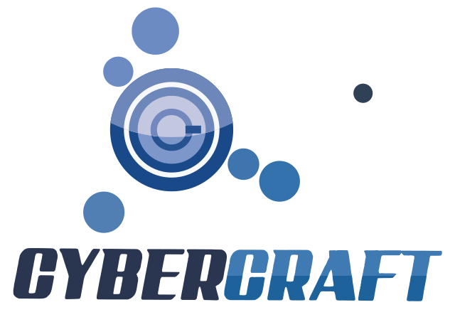
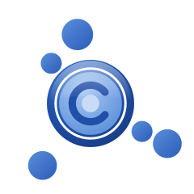

<h1 align="center">CyberCraft Pvt. Ltd.</h1>

<b><i>An Innovation Technology Company</i></b> Managed Services · Cyber Security Compliance & Audit · New Inventions & Horizons

---

## Contents

1. [Company Overview](#1-company-overview)
2. [Our Three Core Pillars](#2-our-three-core-pillars)
3. [At a Glance](#3-at-a-glance)
4. [Our Story](#4-our-story)
5. [Vision, Mission & Values](#5-vision-mission--values)
6. [Message from the CEO](#6-message-from-the-ceo)
7. [Global Presence](#7-global-presence)
8. [Pillar 1 — Managed Services Provider](#8-pillar-1--managed-services-provider)
9. [Pillar 2 — Cyber Security Compliance & Audit](#9-pillar-2--cyber-security-compliance--audit)
10. [Pillar 3 — New Inventions & Horizons](#10-pillar-3--new-inventions--horizons)
11. [Supporting Capabilities](#11-supporting-capabilities)
12. [Products & Platforms](#12-products--platforms)
13. [Industries We Serve](#13-industries-we-serve)
14. [How We Engage](#14-how-we-engage)
15. [Delivery Methodology](#15-delivery-methodology)
16. [Technology Ecosystem](#16-technology-ecosystem)
17. [Partnerships & Joint Ventures](#17-partnerships--joint-ventures)
18. [Our Own Standards](#18-our-own-standards)
19. [Why CyberCraft](#19-why-cybercraft)
20. [Our Clients](#20-our-clients)
21. [Sustainability & Social Responsibility](#21-sustainability--social-responsibility)
22. [People & Careers](#22-people--careers)
23. [Contact Us](#23-contact-us)

---

## 1. Company Overview

**CyberCraft Pvt. Ltd.** is an **Innovation Technology Company**. We do three things for our clients:

1. **We run their IT.** As a **Managed Services Provider**, CyberCraft takes responsibility for a client's technology operations: from a help desk and resident engineers to complete IT outsourcing at a fixed, competitive cost.
2. **We secure it and prove it.** Through **Cyber Security Compliance & Audit**, we assess, certify-ready and continuously monitor our clients against the standards their regulators, customers and boards expect.
3. **We invent what comes next.** Through **New Inventions & Horizons**, we adapt, innovate and improvise to develop and deploy new technology in clean energy, automation, embedded systems, IoT and AI.

Founded in **2007** in **Lahore, Pakistan**, CyberCraft spent its first 17 years building software, ERP systems, data centers and networks for organizations across Pakistan. That engineering depth is the foundation of everything we manage, secure and invent today. In **2024** the company was incorporated as **CyberCraft Pvt. Ltd.** and now operates in **Pakistan, the UAE, Saudi Arabia, the United Kingdom, the Czech Republic and Canada**.

CyberCraft delivers through its own teams and a network of **joint-venture (JV) partners**, which lets it take on engagements of any size while keeping costs competitive.

---

## 2. Our Three Core Pillars

| | **1. Managed Services Provider** | **2. Cyber Security Compliance & Audit** | **3. New Inventions & Horizons** |
|---|---|---|---|
| **Promise** | *We run your IT* | *We secure it and prove it* | *We invent what comes next: Adapt · Innovate · Improvise* |
| **What it covers** | Complete IT outsourcing, resident engineers, service desk, 24/7 NOC, infrastructure, cloud and communications, run as a service | Security audits, VAPT, compliance readiness for international and regional standards, GRC, managed SOC, virtual CISO | R&D and deployment of clean energy, automation, embedded systems, IoT, AI, robotics and health-tech |
| **Client outcome** | Predictable cost, SLA-backed uptime, no hiring overhead | Audit-ready, regulator-ready, measurably safer | New capabilities, lower energy cost, competitive edge |
| **Lead product family** | **CyberCraft Care** | **CyberCraft Secure** | **CyberCraft Horizons** |

Everything else we do (software, ERP, data centers, networks, cloud hosting, procurement and contact center) supports these three pillars. See [Supporting Capabilities](#11-supporting-capabilities).

---

## 3. At a Glance

| | |
|---|---|
| **Legal name** | CyberCraft Pvt. Ltd. |
| **Founded** | 2007 (sole proprietorship) |
| **Incorporated** | 2024 (Private Limited company) |
| **Headquarters** | Lahore, Pakistan |
| **Presence** | Pakistan · UAE · KSA · UK · Czech Republic · Canada |
| **Founder & CEO** | Tauseef Ahmed |
| **Core pillars** | Managed Services · Cyber Security Compliance & Audit · New Inventions & Horizons |
| **Lead products** | CyberCraft Care · CyberCraft Secure · CyberCraft Horizons |
| **Platforms** | CyberERP · b2cloud.io |
| **Delivery model** | Onsite · Offshore (Lahore) · Hybrid · Resident engineers · JV partners |
| **Tagline** | *An Innovation Technology Company* |

---

## 4. Our Story

CyberCraft started in 2007 with a simple idea: **help businesses work better with technology.** Our first work was bringing computers, networks and software into offices across Lahore.

Over the years we built software, our own ERP platform **CyberERP**, and data centers and networks for our clients. Clients kept asking us to stay on and run what we had built, so we became a **Managed Services Provider**, placing resident engineers inside client organizations and, in many cases, running a client's entire IT function.

Running clients' systems made one thing clear: **every system we manage must also be secure, and our clients must be able to prove it** to regulators, auditors and customers. That led to our second pillar, **Cyber Security Compliance & Audit**.

In **2024** we incorporated as **CyberCraft Pvt. Ltd.**, expanded to five more countries, and launched our third pillar, **New Inventions & Horizons**, where we develop and deploy the technologies of the next decade: clean energy, automation, embedded systems, IoT and AI.

| Year | Milestone |
|---|---|
| **2007** | CyberCraft founded in Lahore as a sole proprietorship |
| **2007 onward** | Computerization, networking, software and ERP for businesses |
| **Growth years** | Data center, network, IP communications and surveillance projects |
| **Growth years** | Managed services and the resident-engineer model launched |
| **Growth years** | Cyber security audit and compliance practice established; b2cloud.io launched |
| **2024** | Incorporated as CyberCraft Pvt. Ltd.; identity: *An Innovation Technology Company* |
| **2024 onward** | Presence in UAE, KSA, UK, Czech Republic and Canada; New Inventions & Horizons pillar launched |

> *Exact years for the milestones marked "Growth years" can be added later.*

---

## 5. Vision, Mission & Values

### Vision
*To be the trusted partner that runs, secures and reinvents technology for organizations, from Pakistan to the world.*

### Mission
*To keep our clients' technology running, secure and compliant through managed services and cyber security assurance, and to invent the solutions that open new horizons for them.*

### Core Values

| Value | What it means at CyberCraft |
|---|---|
| **Accountability** | When we manage a system, we own its outcome |
| **Integrity** | Honest findings in every audit and honest advice in every proposal |
| **Vigilance** | Security and compliance are continuous work, not an annual event |
| **Innovation** | We adapt, innovate and improvise, and invest in new inventions, not just existing products |
| **Value for Money** | Enterprise-grade service at a cost that makes sense |
| **Continuous Learning** | Threats, standards and technology change, and so do our skills |

---

## 6. Message from the CEO

> *"When I started CyberCraft in 2007, our goal was simple: help businesses use technology to work better. Over the years we built software, ERP systems, data centers and networks, and our clients trusted us to keep running them. That trust is the heart of our first pillar, managed services.*
>
> *Today every organization faces the same two questions: is our technology secure, and can we prove it? Our second pillar, cyber security compliance and audit, exists to answer both, honestly and to international standards.*
>
> *Our third pillar, new inventions and horizons, is our commitment to the future. Clean energy, automation, embedded systems and AI will change how every business works, and we intend to help invent that change, not just watch it.*
>
> *Becoming CyberCraft Pvt. Ltd. in 2024, and expanding to the UAE, KSA, UK, Czech Republic and Canada, is a new chapter for us. What we stand for has not changed: accountability, honest advice and real value for every client.*
>
> *Thank you for trusting CyberCraft. We look forward to building the future with you."*
>
> **— Tauseef Ahmed**
> Founder & CEO, CyberCraft Pvt. Ltd.

---

## 7. Global Presence

| Location | Role | Focus |
|---|---|---|
| 🇵🇰 **Lahore, Pakistan** | Headquarters and delivery center | Managed services, NOC/SOC, audit team, R&D lab |
| 🇦🇪 **United Arab Emirates** | Regional presence (Middle East) | Managed services, UAE IA / DESC compliance, smart solutions |
| 🇸🇦 **Kingdom of Saudi Arabia** | Regional presence (Middle East) | Managed services, NCA / SAMA compliance, energy |
| 🇬🇧 **United Kingdom** | Regional presence (Europe) | Managed services, Cyber Essentials, ISO 27001, UK GDPR |
| 🇨🇿 **Czech Republic** | Regional presence (Central Europe) | Managed services, GDPR and NIS2 readiness, automation |
| 🇨🇦 **Canada** | Regional presence (North America) | Managed services, PIPEDA and SOC 2 readiness |

**Global delivery model:** clients in every region work with a local point of contact, backed by our 24/7 operations, security and engineering center in Lahore.

---

## 8. Pillar 1 — Managed Services Provider

> ***We run your IT.*** CyberCraft takes responsibility for your technology operations, so your team can focus on your business.

### 8.1 Managed Service Offerings

| Service | What's included |
|---|---|
| **Complete IT outsourcing** | CyberCraft runs the client's entire IT function (infrastructure, users, applications, vendors and security) at a fixed monthly cost |
| **Resident engineers** | Qualified engineers placed full-time at the client's site, managed and backed by CyberCraft |
| **IT staff augmentation** | Engineers, administrators, developers and specialists on demand |
| **Service desk** | L1, L2 and L3 support by phone, email, chat, WhatsApp and remote session, with SLAs |
| **24/7 NOC** | Monitoring of servers, networks, applications, links and uptime |
| **Managed infrastructure** | Servers, storage, virtualization, backups, patching and capacity |
| **Managed networks** | LAN/WAN, Wi-Fi, SD-WAN, firewalls and links |
| **Managed cloud** | b2cloud.io, AWS, Azure, Google Cloud and Microsoft 365 administration |
| **Managed communications** | IP PBX, VoIP, video conferencing and contact center platforms |
| **Managed surveillance** | IP CCTV, access control and central monitoring |
| **Managed print & end-user devices** | Laptops, desktops, printers, imaging and device lifecycle |
| **Annual Maintenance Contracts (AMC)** | Preventive and corrective maintenance for hardware and networks |
| **IT asset & license management** | Inventory, lifecycle, renewals and license compliance |
| **Vendor management** | One point of contact for every IT vendor and ISP |
| **Virtual CIO** | IT strategy, budgets and roadmaps for growing companies |

### 8.2 Service Plans: CyberCraft Care

| Plan | For | Scope |
|---|---|---|
| **Care Essential** | Small businesses | Remote service desk, monitoring, patching, backup checks |
| **Care Professional** | Growing businesses | Essential plus scheduled onsite visits, AMC and asset management |
| **Care Enterprise** | Large organizations | Complete IT outsourcing, 24/7 NOC, a dedicated service manager and SLAs |
| **Care Resident** | Any size | Dedicated resident engineers at the client's premises |

### 8.3 How We Run It
- **Onboarding**: discovery, documentation and stabilization in the first 30 to 90 days
- **ITIL processes**: incident, request, problem, change and asset management
- **SLAs**: agreed response and resolution times, reported monthly
- **Monthly service reviews**: tickets, uptime, risks and improvement plans
- **Security built in**: every managed environment is hardened and monitored by our security team

**Why clients choose it:** predictable cost · SLA-backed uptime · no hiring or training overhead · enterprise tools and processes · one accountable partner

---

## 9. Pillar 2 — Cyber Security Compliance & Audit

> ***We secure it and prove it.*** Independent, honest assessment against the standards your regulators, customers and board expect, followed by the help to close the gaps and stay compliant.

### 9.1 Audit & Assessment
- Information security audits and gap assessments
- Vulnerability assessment and penetration testing (VAPT): network, web, mobile, API, cloud and wireless
- Red team exercises and social engineering / phishing simulation
- Configuration and hardening reviews (servers, firewalls, cloud, Microsoft 365)
- Source code security review
- Risk assessments and third-party / vendor risk assessments
- IT general controls (ITGC) reviews for financial auditors
- OT and industrial control system security assessments

### 9.2 Compliance Readiness
We prepare clients for certification and regulatory inspection: gap assessment, remediation roadmap, policies and procedures, evidence collection, internal audit and support during the external audit.

| Region | Standards and regulations |
|---|---|
| **International** | ISO/IEC 27001, ISO 27701 (privacy), ISO 22301 (business continuity), ISO 20000, PCI DSS, SOC 2, NIST Cybersecurity Framework, CIS Controls, HIPAA |
| **Pakistan** | State Bank of Pakistan cyber and IT risk frameworks, SECP requirements, PTA regulations, PECA 2016 |
| **Saudi Arabia** | NCA Essential Cybersecurity Controls (ECC), SAMA Cyber Security Framework, Personal Data Protection Law (PDPL) |
| **United Arab Emirates** | UAE Information Assurance Standards, Dubai DESC ISR, Abu Dhabi ADHICS (healthcare), UAE PDPL |
| **United Kingdom** | Cyber Essentials / Cyber Essentials Plus, UK GDPR |
| **European Union (Czech Republic)** | GDPR, NIS2 Directive |
| **Canada** | PIPEDA and provincial privacy laws |

### 9.3 Governance, Risk & Compliance (GRC)
- Information security policies, standards and procedures
- Risk registers and risk treatment plans
- Business continuity and disaster recovery planning and testing
- Data protection and privacy programs (data mapping, DPIAs, DPO support)
- Security awareness training programs
- **Virtual CISO**: ongoing security leadership and board reporting

### 9.4 Managed Security (Continuous Compliance)
- 24/7 managed SOC and SIEM monitoring
- Threat detection, incident response and digital forensics
- Managed firewall/UTM, endpoint (EDR), email and DNS security
- Multi-factor authentication, privileged access management and data loss prevention
- Vulnerability management (scheduled scanning and remediation tracking)
- DDoS protection and web application firewalls
- Continuous compliance monitoring and evidence dashboards

### 9.5 Service Packages: CyberCraft Secure

| Package | What it delivers |
|---|---|
| **Secure Audit** | Independent audit and VAPT with a prioritized findings report |
| **Secure Comply** | Certification and regulatory readiness for the standards above |
| **Secure SOC** | 24/7 monitoring, detection and incident response |
| **Secure Shield** | Managed endpoint, email, firewall and identity protection |
| **Secure Aware** | Security awareness training and phishing simulation |
| **Secure vCISO** | Ongoing security leadership, risk management and board reporting |

### 9.6 Our Audit Approach
1. **Scope**: agree systems, standards and objectives
2. **Assess**: interviews, document review, technical testing
3. **Report**: findings rated by risk, with clear remediation steps
4. **Remediate**: optional hands-on help to close the gaps
5. **Verify**: re-test and confirm closure
6. **Sustain**: continuous monitoring and periodic re-assessment

**Independence:** when CyberCraft both manages and audits a client's systems, audit work is performed by a separate team, and clients can request third-party validation.

---

## 10. Pillar 3 — New Inventions & Horizons

> ***We invent what comes next.*** **Adapt · Innovate · Improvise.** The CyberCraft Horizons lab turns emerging technology into practical products and deployments that work in the real world.

| | |
|---|---|
| **Adapt** | Take proven global technology and fit it to local conditions, budgets, regulations and climates |
| **Innovate** | Design new products and solutions in our lab, from embedded devices to AI and energy systems |
| **Improvise** | Solve problems on the ground with what is available: power outages, remote sites, tight budgets and harsh environments |

### 10.1 Horizon Areas

| Area | What we develop and deploy |
|---|---|
| **Solar & clean energy** | Residential, commercial and industrial solar; on-grid, off-grid and hybrid systems; solar–wind hybrids for telecom sites; battery energy storage; net metering; EV charging; energy monitoring software; O&M |
| **Industrial automation** | PLC, SCADA, HMI and DCS; MES and Industry 4.0; batch and process control; machine vision inspection; control panels; predictive maintenance |
| **Embedded systems & electronics** | Custom hardware, PCB design, firmware and device prototyping |
| **Internet of Things** | Sensors, gateways, telemetry, remote monitoring and dashboards; M2M connectivity |
| **Smart living & smart cities** | Home automation, smart buildings and BMS, smart metering, intelligent transport, smart street lighting, city surveillance |
| **Artificial intelligence** | AI assistants and chatbots, intelligent document processing, predictive analytics, computer vision, agentic AI automation |
| **Robotics & drones** | Inspection, surveying, agriculture and security drones; robotic process automation |
| **Health-tech & biotech** | Remote patient monitoring, wearables, medical device integration, life-science technology |
| **Digital twins & emerging tech** | Digital twins, blockchain, AR/VR |

### 10.2 Product Family: CyberCraft Horizons

| Product | Description |
|---|---|
| **Horizons Energy** | Solar, storage, EV charging and energy monitoring for homes, businesses and telecom sites |
| **Horizons Automate** | Industrial automation, MES and machine vision |
| **Horizons IoT** | Sensors, gateways and monitoring platforms |
| **Horizons Smart** | Smart home, smart building and smart city solutions |
| **Horizons AI** | AI assistants, document AI, analytics and computer vision |
| **Horizons Labs** | Custom invention projects: prototypes, embedded devices and pilots built with clients |

### 10.3 How the Lab Works
1. **Discover**: find a real problem with a client or in the market
2. **Prototype**: build quickly in the Lahore lab
3. **Pilot**: test with clients in real conditions
4. **Scale**: turn successful pilots into products and services

---

## 11. Supporting Capabilities

These are the engineering capabilities CyberCraft has built since 2007. They support our three pillars and are also available as standalone services.

| Capability | Highlights |
|---|---|
| **Software engineering** | Web, mobile and desktop applications; APIs and integration; UI/UX; QA; DevOps; legacy modernization |
| **ERP solutions** | Our own **CyberERP** platform, plus implementation, consultancy and support for Microsoft Dynamics 365, SAP and Oracle |
| **Industry solutions** | Hospital and EHR, education, sales and distribution, lending and leasing, transport ticketing, real estate, government e-services |
| **Data centers** | Design and build, servers, storage, virtualization, power, cooling, fire suppression, DR sites |
| **Networks & telecom** | LAN/WAN, fiber and structured cabling, Wi-Fi, SD-WAN, wireless links, satellite connectivity, tower and fiber rollout |
| **IP communications** | IP PBX / IP exchange, VoIP, SIP trunking, unified communications, video conferencing |
| **Security & surveillance systems** | IP CCTV, video analytics, ANPR, face recognition, access control, fire alarm, safe-city projects |
| **Cloud & hosting: b2cloud.io** | Web hosting, VPS, dedicated servers, email, domains, ERP hosting, colocation, backup and DR as a service |
| **Digitization** | Document scanning, digital archives, document management systems, workflows |
| **IT procurement** | Software licensing and IT hardware supply |
| **Contact center** | Inbound and outbound operations, omnichannel support, AI voice agents |

---

## 12. Products & Platforms

| Product family | Pillar | Offerings |
|---|---|---|
| **CyberCraft Care** | Managed Services | Care Essential · Care Professional · Care Enterprise · Care Resident |
| **CyberCraft Secure** | Cyber Security Compliance & Audit | Secure Audit · Secure Comply · Secure SOC · Secure Shield · Secure Aware · Secure vCISO |
| **CyberCraft Horizons** | New Inventions & Horizons | Horizons Energy · Horizons Automate · Horizons IoT · Horizons Smart · Horizons AI · Horizons Labs |
| **CyberERP** | Supporting platform | Finance, Sales & CRM, Procurement, Inventory, Manufacturing, HR & Payroll, POS, Projects, Fixed Assets, BI; industry editions for Retail, Manufacturing, Education, Healthcare, Real Estate, Finance and Services |
| **b2cloud.io** | Supporting platform | Host · VPS · Dedicated · Mail · Domains · Backup · DR · Colo · ERP Cloud |

> *Product names other than CyberERP and b2cloud.io are proposed. Run a trademark check before using them publicly.*

---

## 13. Industries We Serve

| Industry | Managed Services | Compliance & Audit | Horizons |
|---|---|---|---|
| **Banking, Financial Services & Insurance** | Branch IT, NOC, resident engineers | SBP / SAMA frameworks, PCI DSS, ISO 27001, VAPT | AI fraud and document automation |
| **Government & Public Sector** | IT outsourcing, data center operations | National standards, audits, awareness | Smart city, e-governance |
| **Telecom & ISPs** | Network operations, NOC | PTA requirements, VAPT | Tower solar power, IoT |
| **Healthcare & Life Sciences** | Hospital IT management | HIPAA, ADHICS, data protection | Remote patient monitoring |
| **Education** | Campus IT management | Data protection, awareness | Smart campus |
| **Manufacturing** | Plant IT and OT support | OT security, ISO 27001 | Industrial automation, machine vision |
| **Retail, FMCG & Distribution** | Store and warehouse IT | PCI DSS, VAPT | Energy, analytics |
| **Energy, Oil & Gas, Utilities** | Remote site IT, satellite links | OT and SCADA security | Solar, SCADA, smart metering |
| **Real Estate & Construction** | Site connectivity, surveillance | Access-control audits | Smart buildings |
| **Transportation & Logistics** | Fleet and depot IT | Data protection | Fleet IoT |
| **Hospitality & Travel** | Hotel IT, guest Wi-Fi | PCI DSS | Smart rooms |
| **NGOs & Development Sector** | Low-cost IT management | Donor data protection | Solar for communities |

---

## 14. How We Engage

### Run → Secure → Invent

| Stage | What we do |
|---|---|
| **Run** | Take over and stabilize the client's IT under a managed services agreement |
| **Secure** | Audit, harden and bring the environment to compliance, then monitor it continuously |
| **Invent** | Introduce new technology (energy, automation, AI) that lowers cost or creates new capability |

### Engagement Models

| Model | Best for |
|---|---|
| **Managed services (monthly)** | IT operations, security and surveillance with SLAs |
| **Resident engineers / staff augmentation** | Adding skilled people to the client's team |
| **Audit engagement (fixed fee)** | Defined-scope audit, VAPT or compliance readiness |
| **Retainer** | Virtual CISO, virtual CIO, continuous compliance |
| **Turnkey project** | Data center, network, solar plant or automation project |
| **Innovation pilot** | Proof of concept with the Horizons lab |
| **Build-Operate-Transfer (BOT)** | Setting up a client's IT or SOC and handing it over |
| **JV / consortium** | Large and government programs with our partners |

---

## 15. Delivery Methodology

1. **Discover**: understand the business, systems, risks and goals
2. **Design**: service design, audit scope or solution architecture
3. **Transition / Deploy**: onboarding, stabilization or project delivery
4. **Operate**: run under SLAs with ITIL processes
5. **Assure**: audit, monitor and report against agreed standards
6. **Improve**: monthly reviews, roadmaps and new innovations

**Governance:** a dedicated service or project manager · monthly service reviews · SLA and compliance dashboards · steering committee for large engagements

---

## 16. Technology Ecosystem

| Area | Technologies we work with |
|---|---|
| **Service management** | ITSM ticketing, remote monitoring and management (RMM), NOC dashboards |
| **Security** | SIEM, EDR/XDR, next-gen firewalls, PAM, MFA, WAF, vulnerability scanners, penetration testing toolkits |
| **Infrastructure** | VMware, Hyper-V, Proxmox, Windows Server, Linux, SAN/NAS, backup platforms |
| **Cloud** | AWS, Microsoft Azure, Google Cloud, Oracle Cloud, Microsoft 365, b2cloud.io |
| **Networking** | Enterprise routing, switching, wireless, SD-WAN, satellite |
| **Automation & energy** | PLC/SCADA/HMI platforms, IoT gateways, solar inverters, lithium storage |
| **AI & data** | Large language models, OCR/IDP, computer vision, Power BI |
| **Software & ERP** | CyberERP, Dynamics 365, SAP, Oracle; .NET, Java, PHP, Python, Node.js, React, Flutter |

---

## 17. Partnerships & Joint Ventures

CyberCraft works through a network of **joint-venture (JV) partners** in Pakistan and abroad. These partnerships let us:

- Bid for and deliver **large-scale and government programs**
- Get specialized and certified resources (auditors, penetration testers, engineers) when needed
- Source hardware, software and energy equipment at competitive prices
- Provide local presence and support in the **UAE, KSA, UK, Czech Republic and Canada**

**We welcome partnerships** with technology vendors, audit firms, system integrators, distributors and investors who share our vision.

> *Vendor partnerships and accreditations can be listed here once formalized.*

---

## 18. Our Own Standards

We apply to ourselves the standards we audit for others:

| Area | Standard / framework |
|---|---|
| **Information security** | ISO 27001 practices |
| **IT service management** | ITIL processes; ISO 20000 practices |
| **Quality management** | ISO 9001 practices |
| **Audit work** | Independent audit teams, documented methodology, client confidentiality and NDAs |
| **Software delivery** | Agile/Scrum, secure coding (OWASP) |

> *Certification targets: ISO 27001, ISO 20000 and ISO 9001. Team certifications to list once confirmed (for example CISA, CISSP, CEH, OSCP, ISO 27001 Lead Auditor, ITIL).*

---

## 19. Why CyberCraft

| | |
|---|---|
| 🛠️ **We run it** | 17+ years of building and managing IT; resident engineers and complete outsourcing |
| 🛡️ **We secure and prove it** | Audits and compliance readiness for international, Middle East, UK, EU and Canadian standards |
| 🚀 **We invent** | A dedicated lab for clean energy, automation, IoT and AI |
| 🔗 **One accountable partner** | Run, secure and innovate under one agreement |
| 💰 **Lower total cost** | Lahore delivery center and resident-engineer model |
| 🌍 **International presence** | Pakistan, UAE, KSA, UK, Czech Republic, Canada |
| 🧩 **Engineering depth** | Our own ERP, software, data center and network expertise |
| 🤝 **Scalable delivery** | Own teams plus a JV partner network |
| ⚖️ **Honest audits** | Independent audit teams and clear, risk-rated findings |
| 🙋 **Personal attention** | Senior leadership involved in every key account |

---

## 20. Our Clients

> ⚠️ **Sample placeholders.** The names below are fictitious and must be replaced with real client names and logos before the website goes live.

| | | | |
|---|---|---|---|
|  |  |  |  |
|  |  |  |  |

### Sample Case Studies (placeholders)

**Contoso Group: complete IT outsourcing** *(sample, Managed Services)*
- **Challenge:** high IT costs and an unreliable in-house setup
- **Solution:** CyberCraft Care Enterprise with resident engineers and 24/7 NOC
- **Result:** predictable monthly IT costs and SLA-backed uptime

**Woodgrove Bank: regulatory compliance and SOC** *(sample, Compliance & Audit)*
- **Challenge:** a regulator's cyber framework deadline and no 24/7 monitoring
- **Solution:** Secure Comply gap assessment and remediation, then Secure SOC
- **Result:** inspection-ready controls and round-the-clock monitoring

**Litware Health: ISO 27001 readiness** *(sample, Compliance & Audit)*
- **Challenge:** patient data across many systems and a client demanding certification
- **Solution:** Secure Audit, policy framework, VAPT and internal audit
- **Result:** ready for the external ISO 27001 certification audit

**Fabrikam Industries: solar and plant automation** *(sample, Horizons)*
- **Challenge:** rising energy costs and manual production monitoring
- **Solution:** Horizons Energy solar with storage, plus Horizons Automate SCADA dashboards
- **Result:** lower energy bills and real-time production visibility

---

## 21. Sustainability & Social Responsibility

- **Clean energy**: helping clients cut costs and carbon through solar and energy efficiency
- **Green IT**: energy-efficient data centers, virtualization and certified e-waste recycling
- **Cyber safety**: free awareness sessions for schools, SMEs and NGOs
- **Skills development**: internships and training for young IT and security graduates
- **Community**: technology access for underserved communities

---

## 22. People & Careers

CyberCraft's strength is its people: service desk and NOC engineers, resident engineers, security auditors and penetration testers, SOC analysts, solar and automation engineers, developers and ERP consultants.

**Why work with us:**
- Real responsibility for live client systems
- Security and audit work to international standards
- Invention projects in the Horizons lab
- International exposure across six countries
- Certification support (ITIL, CEH, OSCP, CISA, ISO 27001 Lead Auditor and more)

**Career areas:** Managed Services · Cyber Security & Audit · Horizons R&D · Infrastructure & Networks · Cloud · Software & ERP · Sales & Business Development

---

## 23. Contact Us

| | |
|---|---|
| **Head Office** | Lahore, Pakistan *(full address to be added)* |
| **UAE** | *(address to be added)* |
| **KSA** | *(address to be added)* |
| **UK** | *(address to be added)* |
| **Czech Republic** | *(address to be added)* |
| **Canada** | *(address to be added)* |
| **Phone / WhatsApp** | *(to be added)* |
| **Email** | *(to be added)* |
| **Website** | *(to be added)* |
| **Cloud & Hosting** | b2cloud.io |

---

 <b>CyberCraft Pvt. Ltd.</b> <i>An Innovation Technology Company</i>

