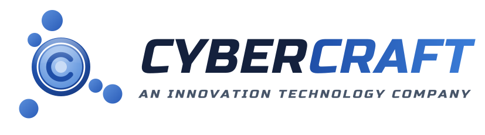

# CyberCraft Pvt. Ltd. — Company Profile

> ## *An Innovation Technology Company*
> **IT · Telecom · Innovation**

---

## About Us

CyberCraft Pvt. Ltd. is an **Innovation Technology Company** working across three pillars: **Information Technology, Telecommunications and Innovation Technology**.

Founded in **2007** in Lahore, Pakistan, CyberCraft has spent more than 17 years helping organizations computerize, automate and transform digitally. In **2024** the company was incorporated as **CyberCraft Pvt. Ltd.**, which opened its next chapter as a full-spectrum technology partner with an international footprint.

Today CyberCraft is one partner that can **consult, build, run and secure** a client's entire technology estate: software and ERP, data centers and networks, communications, cloud, cybersecurity and managed IT operations. It is also investing in the technologies of tomorrow: clean energy, automation, embedded systems, AI and beyond.

CyberCraft delivers through its own teams and a network of **joint-venture (JV) partners**, which lets it scale for projects of any size while keeping costs competitive.

## At a Glance

| | |
|---|---|
| **Founded** | 2007 (incorporated as Pvt. Ltd. in 2024) |
| **Headquarters** | Lahore, Pakistan |
| **Presence** | Pakistan · UAE · KSA · UK · Czech Republic · Canada |
| **Pillars** | IT · Telecom · Innovation Technology |
| **Service lines** | 18 |
| **Brands** | CyberCraft · CyberERP · b2cloud.io |

## Our Presence

| Location | Role |
|---|---|
| **Lahore, Pakistan** | Headquarters and delivery center |
| **United Arab Emirates** | Regional presence (Middle East) |
| **Kingdom of Saudi Arabia** | Regional presence (Middle East) |
| **United Kingdom** | Regional presence (Europe) |
| **Czech Republic** | Regional presence (Central Europe) |
| **Canada** | Regional presence (North America) |

## Vision

*To be a leading innovation technology company, building the digital, connected and sustainable future of businesses and communities, from Pakistan to the world.*

## Mission

*To deliver complete, reliable and cost-effective IT, Telecom and emerging-technology solutions, from first consultation to long-term managed operations, so our clients can focus on growing their business.*

## Core Values

- **Innovation**: we look for better ways to solve problems
- **Integrity**: honest advice and transparent pricing
- **Reliability**: we deliver what we commit
- **Customer First**: our clients' success is our success
- **Value for Money**: enterprise quality at competitive cost
- **Continuous Learning**: always ready for the next technology

---

## Message from the CEO

> *"When I started CyberCraft in 2007, our goal was simple: help businesses use computers to work better. Technology has changed a lot since then, and so have we. We have gone from computerizing offices to implementing ERP systems, building data centers, securing networks and running complete IT operations for our clients.*
>
> *Becoming CyberCraft Pvt. Ltd. in 2024, and expanding to the UAE, KSA, UK, Czech Republic and Canada, is a new chapter for us. It does not change what we stand for: honest advice, dependable delivery and real value for every client.*
>
> *We call ourselves an Innovation Technology Company because we believe the next decade belongs to those who innovate, in software, in connectivity, in clean energy and in automation. Our promise is to bring those innovations to you, practically and affordably.*
>
> *Thank you for trusting CyberCraft. We look forward to building the future with you."*
>
> **— Tauseef Ahmed**
> Founder & CEO, CyberCraft Pvt. Ltd.

---

## How We Engage: Consult → Build → Run → Secure

| Stage | What we do |
|---|---|
| **Consult** | Assessments, roadmaps, solution design, ERP selection, security audits |
| **Build** | Software, ERP implementation, data centers, networks, solar and automation projects |
| **Run** | Managed IT, resident engineers, NOC, hosting, contact center, AMC |
| **Secure** | SOC monitoring, compliance, incident response, continuous improvement |

---

## Our Services

### PILLAR 1 — Information Technology

#### 1. Software Engineering
- Web applications, portals, e-commerce and SaaS platforms
- Mobile apps: Android, iOS and cross-platform
- Desktop applications
- APIs and system integration
- UI/UX design, QA and test automation, DevOps
- Legacy application modernization

#### 2. ERP Solutions: our core strength
- **CyberERP**: CyberCraft's own ERP platform
- **Third-party ERP implementation**: Microsoft Dynamics 365, SAP and Oracle (Fusion Cloud / E-Business Suite / NetSuite)
- Full ERP lifecycle: requirements, implementation, data migration, customization, upgrades, training, go-live and post-go-live support
- ERP consultancy: business process reengineering, ERP selection and health checks
- ERP managed services (application management and support)
- CRM and supply chain management

#### 3. Industry Solutions
Custom-built solutions for specific sectors:
- Hospital management, electronic health records (EHR) and telemedicine
- School, college and university management (student information systems)
- Sales and distribution / field-force mobility
- Lending, leasing and microfinance systems
- Fleet, transport ticketing and fare-collection systems
- Real-estate and property management
- Government e-services and citizen portals

#### 4. Data & Artificial Intelligence
- Data engineering, data warehousing and data migration
- Business intelligence and Power BI dashboards
- Advanced and predictive analytics
- Generative AI, chatbots and AI assistants
- Agentic AI and intelligent process automation (RPA)
- Intelligent document processing (OCR and data extraction)
- Computer vision

#### 5. Managed IT Services (MSP)
- **Complete IT outsourcing**: we run a client's entire IT function at a fixed, competitive cost
- **Resident engineers**: dedicated on-site staff
- IT staff augmentation (engineers and developers)
- Help desk and service desk (L1, L2, L3) with SLAs
- 24/7 NOC monitoring, patching and uptime management
- Remote infrastructure management
- Annual Maintenance Contracts (AMC)

#### 6. Cloud & Hosting: **b2cloud.io**
- Web hosting, VPS and dedicated servers
- Domains, business email and SSL
- ERP and application hosting
- Colocation and rack hosting
- Backup as a Service, Disaster Recovery as a Service, Storage as a Service
- Cloud migration and management on AWS, Microsoft Azure, Google Cloud and Oracle Cloud
- Local data residency for regulated clients

#### 7. Cybersecurity
- **Assess**: security audits, vulnerability assessment and penetration testing (VAPT), risk assessment
- **Comply**: governance, risk and compliance (GRC) consulting, ISO 27001, PCI-DSS and regulatory frameworks
- **Protect**: next-generation firewalls, endpoint (EDR), email, DNS and web application (WAF) security, multi-factor authentication, privileged access management, data loss prevention
- **Detect and respond**: managed SOC, SIEM, threat monitoring, incident response, DDoS protection
- **OT/industrial security** for plants and critical infrastructure
- Security awareness training · virtual CISO

#### 8. IT Procurement
- **Software licensing**: Microsoft, security software, Adobe, Autodesk, server and OS, and more
- **IT hardware supply**: laptops, desktops, servers, storage, networking equipment, printers, CCTV and UPS
- IT asset lifecycle management and e-waste disposal

### PILLAR 2 — Telecommunications & Infrastructure

#### 9. Data Centers
- Data center design and build (Tier-standard aligned)
- Modular and containerized data centers
- Racks, servers, storage (SAN/NAS), hyper-converged infrastructure and virtualization
- UPS and power systems, precision cooling, fire suppression, DC monitoring (DCIM)
- Backup and disaster recovery sites

#### 10. Networks & Connectivity
- LAN/WAN design and deployment
- Fiber optic and structured cabling (copper and fiber)
- Enterprise and managed Wi-Fi
- SD-WAN, VPN and managed WAN
- Point-to-point and point-to-multipoint wireless links
- **Satellite connectivity** for remote sites, maritime and mobile operations
- **M2M / IoT connectivity**
- Telecom tower and fiber rollout services
- Network operations for telcos and ISPs

#### 11. IP Communications & Collaboration
- IP PBX / IP exchange and VoIP
- SIP trunking
- Unified communications and team collaboration
- Video conferencing and smart meeting rooms
- Audio-visual and digital signage solutions

#### 12. Security & Surveillance Systems
- IP CCTV, NVR and video management systems (VMS)
- Video analytics, ANPR and face recognition
- Access control, time attendance and visitor management
- Fire alarm and public address systems
- Safe-city, campus and managed surveillance

#### 13. Contact Center & Customer Experience (CX)
- Inbound and outbound call center operations
- Omnichannel support (voice, chat, email, social, WhatsApp)
- Telesales and lead generation
- AI voice agents and chatbots working alongside human agents
- Contact-center technology setup and CX analytics

### PILLAR 3 — Innovation Technology

#### 14. Solar & Clean Energy
- On-grid, off-grid and hybrid solar systems (residential, commercial, industrial)
- Solar and wind hybrid solutions, including for telecom sites
- Battery energy storage systems (home, commercial and utility scale)
- Net metering
- EV charging infrastructure
- Energy monitoring and energy-management software

#### 15. Industrial Automation & Embedded Systems
- Industrial automation: PLC, SCADA, HMI, DCS
- Manufacturing execution systems (MES) and Industry 4.0
- Machine vision and quality inspection
- Control panel design and fabrication
- Embedded systems, firmware and custom electronics
- IoT sensors, telemetry and remote monitoring
- Digital twins
- OT managed services

#### 16. Smart Living & Smart Cities
- Home automation
- Smart buildings and building management systems (BMS)
- Smart energy and smart metering
- Smart city platforms, intelligent transport systems and parking

#### 17. Digitization
- Document scanning and digital archiving
- Document management systems (DMS)
- Workflow and e-forms
- Data entry and records conversion

#### 18. Future Technologies & R&D
- AI research and applied machine learning
- Robotics and drones
- Health-tech: remote patient monitoring and medical devices
- Biotech and other emerging fields

---

## Industries We Serve

| | | |
|---|---|---|
| Government & Public Sector | Banking, Financial Services & Insurance | Telecom & ISPs |
| Healthcare & Life Sciences | Education | Manufacturing |
| Retail, FMCG & Distribution | Automotive | Transportation & Logistics |
| Energy, Oil & Gas | Utilities, Water & Wastewater | Real Estate & Construction |
| Food & Beverage | Hospitality & Travel | Media & Entertainment |
| Agriculture | Defense & Security | NGOs & Development Sector |

## Why CyberCraft

- **17+ years of experience**, serving clients since 2007
- **One partner for IT, Telecom and Innovation**: consult, build, run and secure
- **Our own ERP (CyberERP)** plus implementation of Dynamics 365, SAP and Oracle
- **Lower total cost** through managed services and resident engineers
- **Our own cloud brand**: b2cloud.io
- **International presence** in six countries
- **Scalable delivery** through our JV partner network
- **Future-ready**: clean energy, automation, AI and IoT

## Our Clients

> ⚠️ **Sample placeholders.** The names below are fictitious and must be replaced with real client names and logos before the website goes live.

| | | | |
|---|---|---|---|
|  |  |  |  |
|  |  |  |  |

## Our Brands

- **CyberCraft**: parent company for IT, Telecom and Innovation Technology
- **CyberERP**: enterprise resource planning platform
- **b2cloud.io**: cloud and hosting services

## Contact

| | |
|---|---|
| **Head Office** | Lahore, Pakistan *(full address to be added)* |
| **Phone** | *(to be added)* |
| **Email** | *(to be added)* |
| **Website** | *(to be added)* |

---

*CyberCraft Pvt. Ltd. — An Innovation Technology Company.*
